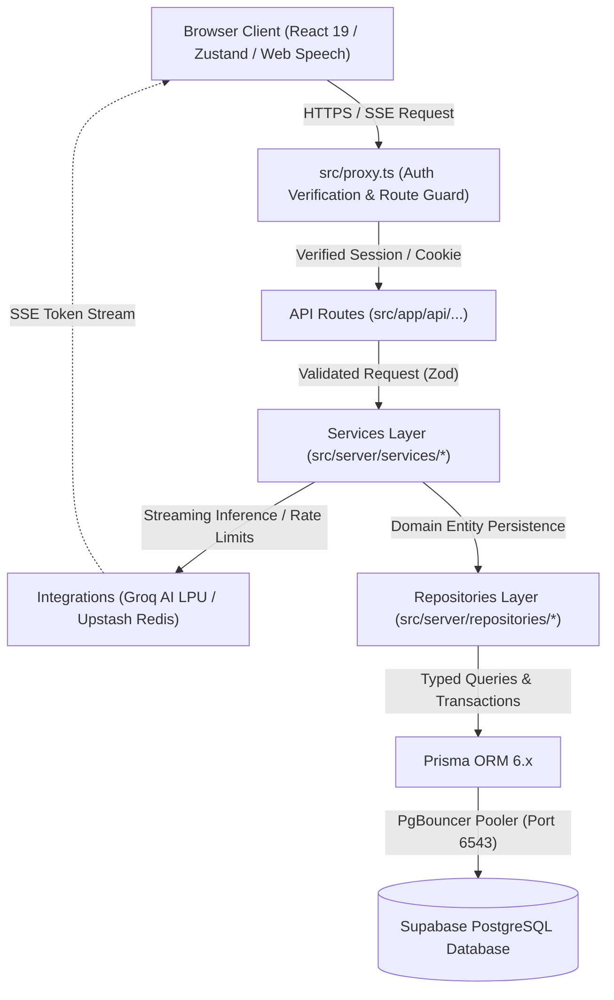

<div align="center">

# 🎯 AI Interviewer App

**Enterprise-Grade, Low-Latency Conversational AI Mock Interviewing Platform**

[](https://github.com/ManojBarmase/ai-interviewer-app/actions/workflows/ci.yml)
[-3178C6?logo=typescript&logoColor=white)](https://www.typescriptlang.org/)
[](#copyright--intellectual-property-notice)
[](https://nextjs.org/)
[](https://www.prisma.io/)

</div>

---

## What is this?

**AI Interviewer App** is an enterprise-grade SaaS platform engineered to deliver realistic, low-latency technical and behavioral mock interviews. Powered by Groq's Language Processing Unit (LPU) architecture running the `qwen/qwen3.8-27b` model, the platform achieves sub-400ms Time-to-First-Token (TTFT) latency over Server-Sent Events (SSE). Candidates can upload their digital PDF resumes, configure interview personas across multiple domains (Technical, Behavioral, System Design, HR), and participate in natural, voice- or text-driven conversations where follow-up questions dynamically probe real project experience rather than generic textbook trivia.

Behind the conversational interface lies an auditable enterprise architecture built with Next.js 16 App Router, React 19, TypeScript strict mode, Prisma ORM 6, and Supabase PostgreSQL. Following completion of an interview turn sequence, the system synthesizes comprehensive evaluation scorecards featuring STAR-method breakdown, skill dimension scoring, constructive recommendations, and persistent analytics heatmaps. The codebase is hardened with layered defense-in-depth security, distributed Upstash Redis rate limiting, prompt injection defenses, PII-redacted structured Pino logging, and Sentry error observability.

---

## Tech Stack

| Technology | Version | Purpose |
| :--- | :--- | :--- |
| **Next.js** | `16.3.8` (App Router) | Server Components, Route Handlers, Route Proxy, SSR |
| **TypeScript** | `5.x` (Strict Mode) | Full-stack end-to-end type safety with zero unchecked operations |
| **Supabase** | PostgreSQL + Auth | Managed relational database and JWT session authentication |
| **Prisma** | `6.19.3` | Type-safe ORM, declarative migrations, schema modeling |
| **Groq AI** | LPU (`qwen/qwen3.8-27b`) | Ultra-low-latency (<400ms TTFT) streaming inference & evaluation |
| **Tailwind CSS** | `v4` | Utility-first styling with modern responsive design |
| **Vitest** | `5.0.5` | Fast unit & integration testing with V8 coverage thresholds |
| **Playwright** | `1.64.1` | End-to-end browser test automation |
| **Upstash Redis** | `@upstash/ratelimit` | Distributed sliding-window rate limiting across serverless lambdas |
| **Pino** | `10.4.0` | High-performance structured JSON logging with GDPR PII masking |
| **Zod** | `4.6.5` | Strict schema validation for incoming payloads and LLM outputs |
| **Zustand** | `5.0.15` | Client-side state machine for active interview sessions |
| **Recharts** | `3.10.1` | Analytics dashboard data visualization |
| **Sentry** | `11.9.0` | Enterprise application monitoring and crash reporting |

---

## Architecture Diagram

The diagram below illustrates the request flow from the candidate's browser through proxy authentication, thin API routes, business services, repositories, and persistence in Supabase:



---

## Project Structure

```
ai-interviewer-app/
├── .github/
│   └── workflows/ci.yml         # CI workflow: type-check, lint, test, format, build
├── e2e/                         # Playwright end-to-end test suites
├── prisma/
│   ├── migrations/              # Version-controlled migration history
│   ├── README.md                # Database runbook, schema design, and migration rules
│   └── schema.prisma            # Database models (User, Session, Transcript, Scorecard)
├── public/                      # Static assets, icons, and fonts
├── scripts/                     # Operational test scripts (DB/Groq connectivity)
├── src/
│   ├── app/                     # Next.js 16 App Router
│   │   ├── api/                 # Thin API route handlers (JSON & SSE endpoints)
│   │   │   ├── auth/demo/       # POST/DELETE guest demo session cookies
│   │   │   ├── health/          # GET health check & latency probe
│   │   │   ├── interview/       # Chat streaming, evaluation, and session lifecycle
│   │   │   └── parse-resume/    # PDF resume parsing endpoint
│   │   ├── dashboard/           # User dashboard & analytics views
│   │   ├── interview/           # Active interview room & setup forms
│   │   ├── login/               # Authentication page
│   │   ├── global-error.tsx     # Enterprise error boundary with Sentry capture
│   │   ├── layout.tsx           # Root HTML layout with SEO metadata
│   │   └── page.tsx             # Landing page
│   ├── components/              # Shared UI components and layouts
│   ├── features/                # Feature-sliced domain modules
│   │   ├── auth/                # Sign-in forms & state
│   │   ├── dashboard/           # Analytics charts, streaks, and score heatmaps
│   │   ├── interview/           # Audio recorder, chat transcript, Zustand store
│   │   └── scorecard/           # Post-interview evaluation scorecard UI
│   ├── lib/                     # Cross-cutting foundational utilities
│   │   ├── config/env.ts        # Fail-fast runtime environment variable validation
│   │   ├── constants/           # Shared constants, enums, and identifiers
│   │   ├── logger.ts            # Pino structured logger with GDPR PII redaction
│   │   ├── supabase/            # Browser and server Supabase clients
│   │   └── validations/         # Zod schemas for LLM outputs and forms
│   ├── server/                  # Server-only modules (import 'server-only' guarded)
│   │   ├── db/prisma.ts         # Prisma client singleton with globalThis caching
│   │   ├── errors/AppError.ts   # Domain error hierarchy
│   │   ├── integrations/        # Groq SDK factory, prompts, Upstash rate limiter
│   │   ├── repositories/        # Data access layer (Session, Scorecard)
│   │   ├── services/            # Business logic (Chat, Evaluation, Resume, Analytics)
│   │   └── utils/               # Centralized error handler, rate limiter, sanitizers
│   ├── types/                   # Shared TypeScript definitions
│   └── proxy.ts                 # Next.js 16 route proxy (renamed from middleware.ts)
├── .env.example                 # Template for local environment variables
├── ARCHITECTURE.md              # Deep-dive architecture and design documentation
├── CHANGELOG.md                 # Keep a Changelog formatted release history
├── CONTRIBUTING.md              # Contribution standards, conventions, and rules
├── next.config.ts               # Next.js configuration with strict security headers
├── package.json                 # Dependencies, scripts, and engine specifications
├── tsconfig.json                # TypeScript strict compiler configuration
└── vitest.config.ts             # Vitest configuration and coverage thresholds
```

---

## Getting Started

### 1. Prerequisites
- **Node.js**: `>= 20.0.0`
- **npm**: `>= 10.0.0`
- **Git**
- Supabase project and Groq Cloud account

### 2. Clone and Install
```bash
git clone https://github.com/ManojBarmase/ai-interviewer-app.git
cd ai-interviewer-app
npm install --legacy-peer-deps
```
> *Note:* Dependency installation automatically triggers `prisma generate` via `postinstall` to compile TypeScript types for your database models.

### 3. Environment Setup
Copy the template and supply your credentials:
```bash
cp .env.example .env.local
```
Configure `.env.local` with your Supabase URL, anon key, Groq API key, database connection URL, and Upstash Redis tokens. Refer to [Environment Variables](#environment-variables) for details.

### 4. Database Setup
Apply all Prisma migrations to your target PostgreSQL database:
```bash
npm run db:migrate
```
*(For development migration authoring, use `npx prisma migrate dev --name <migration_name>`.)*

### 5. Run the Development Server
```bash
npm run dev
```
Open [http://localhost:3000](http://localhost:3000) in your browser.

---

## Available Scripts

| Script | Command | Description |
| :--- | :--- | :--- |
| `npm run dev` | `next dev` | Starts local Next.js development server with hot-reload |
| `npm run build` | `next build` | Compiles optimized production build bundle |
| `npm run start` | `next start` | Runs production server |
| `npm run lint` | `eslint src --max-warnings=0` | Runs ESLint enforcing 0 warnings |
| `npm run lint:fix` | `eslint src --fix` | Automatically corrects fixable lint issues |
| `npm run type-check` | `next typegen && tsc --noEmit` | Validates TypeScript types across the codebase |
| `npm run test` | `vitest run` | Executes all unit and integration test suites |
| `npm run test:watch` | `vitest` | Runs Vitest in interactive watch mode |
| `npm run test:coverage`| `vitest run --coverage` | Generates detailed V8 code coverage report |
| `npm run test:e2e` | `playwright test` | Runs Playwright browser-level E2E tests |
| `npm run health-check` | `curl -s http://localhost:3000/api/health \| jq .` | Checks health endpoint and formats response |
| `npm run audit` | `npm audit --audit-level=high` | Checks installed dependencies for high/critical security advisories |
| `npm run db:migrate` | `prisma migrate deploy` | Applies pending migrations to the database |
| `npm run db:studio` | `prisma studio` | Opens Prisma Studio visual database inspector |
| `npm run format` | `prettier --write ...` | Formats all source files with Prettier |
| `npm run format:check` | `prettier --check ...` | Verifies code formatting conformance |
| `npm run validate` | `type-check + lint + test + format:check` | Full enterprise quality gate runner |

---

## Environment Variables

| Variable | Status | Description |
| :--- | :---: | :--- |
| `NEXT_PUBLIC_APP_URL` | **Required** | Application base URL (e.g. `http://localhost:3000` or production domain) |
| `NEXT_PUBLIC_SUPABASE_URL` | **Required** | Supabase project REST API endpoint URL |
| `NEXT_PUBLIC_SUPABASE_ANON_KEY` | **Required** | Supabase anonymous public API key |
| `DATABASE_URL` | **Required** | PostgreSQL connection URL (port 6543 pooler with `?pgbouncer=true` for app) |
| `GROQ_API_KEY` | **Required** | Groq Cloud API key for ultra-fast LPU inference (`qwen/qwen3.8-27b`) |
| `NEXT_PUBLIC_APP_ENV` | Optional | Runtime tier (`development`, `preview`, `production`, default `development`) |
| `NEXT_PUBLIC_SENTRY_DSN` | Optional | Sentry DSN key for error and exception telemetry |
| `KV_REST_API_URL` | Optional | Upstash Redis REST URL for distributed rate limiting |
| `KV_REST_API_TOKEN` | Optional | Upstash Redis REST authentication token |
| `KV_URL` | Optional | Direct Redis connection URL fallback |
| `LOG_LEVEL` | Optional | Structured logger level (`fatal`, `error`, `warn`, `info`, `debug`, default `info`) |
| `DEMO_MODE_ENABLED` | Optional | Feature flag allowing 1-click guest candidate demo access (default `true`) |
| `NODE_ENV` | Optional | Node environment (`development`, `production`, `test`) |

---

## Testing

The project maintains rigorous test coverage spanning unit, service integration, and end-to-end flows.

```bash
# Run unit and service test suites
npm run test

# Run tests with code coverage analysis
npm run test:coverage

# Run browser end-to-end tests
npm run test:e2e
```

**Coverage Thresholds** (Enforced by Vitest in `vitest.config.ts`):
- **Lines:** `80%`
- **Functions:** `80%`
- **Statements:** `80%`
- **Branches:** `70%`

---

## API Reference

| Method | Endpoint | Auth Required | Description |
| :--- | :--- | :---: | :--- |
| `POST` | `/api/auth/demo` | No | Creates a 24-hour guest demo session cookie |
| `DELETE` | `/api/auth/demo` | No | Clears guest demo session cookies |
| `POST` | `/api/interview/chat` | Yes | SSE streaming real-time AI interview response |
| `POST` | `/api/interview/evaluate` | Yes | Synthesizes and saves Zod-validated evaluation scorecard |
| `POST` | `/api/parse-resume` | Yes | Parses uploaded PDF resume into structured candidate text |
| `GET` | `/api/health` | No | Health check returning service status, uptime, and latency |

---

## Security

The platform adheres to multi-layer enterprise security standards:
- **Strict Content Security Policy (CSP)**: Nonce-based script controls, clickjacking protection (`X-Frame-Options: DENY`), MIME-sniffing prevention (`X-Content-Type-Options: nosniff`), and COOP/COEP isolation configured in `next.config.ts`.
- **Adversarial Prompt Injection Defense**: System prompts are isolated and user inputs are sanitized against injection vectors and delimiter escapes before reaching LLM inference.
- **Distributed Rate Limiting**: Upstash Redis sliding-window algorithms enforce strict per-user request quotas across all serverless lambda instances.
- **Server-Only Boundary Guards**: All database, service, and repository files enforce `import 'server-only'` to guarantee zero confidential server logic enters client bundles.
- **GDPR PII Masking**: Pino logger automatically redacts sensitive fields (`email`, `password`, `token`, `apiKey`, `authorization`, `cookie`) before emitting log streams.
- **Fail-Safe Centralized Error Masking**: Internal server errors and database stack traces are captured by Sentry and hidden behind generic user-facing error messages in production.

---

## Architecture & Code Standards Review

This repository is an enterprise-grade portfolio project designed and developed by **Manoj Barmase** to demonstrate production-ready Next.js architecture, real-time AI streaming, robust observability, and secure cloud database operations.

While this is a proprietary showcase project and not open for external contributions or pull requests, technical reviewers and recruiters can review our engineering discipline and architectural choices here:
- **[System Architecture Guide](./ARCHITECTURE.md)**: Layer isolation, domain responsibilities, WebRTC/SSE streaming, and database schema rationale.
- **[Development Standards & Quality Gates](./CONTRIBUTING.md)**: Conventional Commits, TypeScript strict mode, Zod validation patterns, and PR review checklists followed by the author.

---

## Copyright & Intellectual Property Notice

**Copyright © 2026 [Manoj Barmase](https://github.com/ManojBarmase). All rights reserved.**

This project, its source code, design, and documentation are the proprietary intellectual property of Manoj Barmase. This repository is made publicly accessible on GitHub **exclusively for portfolio demonstration, technical assessment, and candidate evaluation** by prospective employers, engineering managers, and technical recruiters.

- **No Open-Source License Granted:** No license (open-source, commercial, or otherwise) is granted to copy, clone for redistribution, modify, distribute, publish, sublicense, deploy, or commercially exploit this software or any part of it.
- **Evaluation Scope:** Prospective employers, recruiters, and hiring panels are granted non-transferable permission to view, run locally, and evaluate the source code solely for the purpose of candidate assessment.
- **Plagiarism Protection:** You may not copy or reuse this code in personal, academic, or commercial projects. Unauthorized distribution, claiming of authorship, or republishing will be subject to applicable copyright law and GitHub DMCA enforcement.

---

<div align="center">

Developed with enterprise precision by **[Manoj Barmase](https://github.com/ManojBarmase)**

*For technical recruitment, interview opportunities, or engineering inquiries, please connect via [GitHub](https://github.com/ManojBarmase).*

</div>
